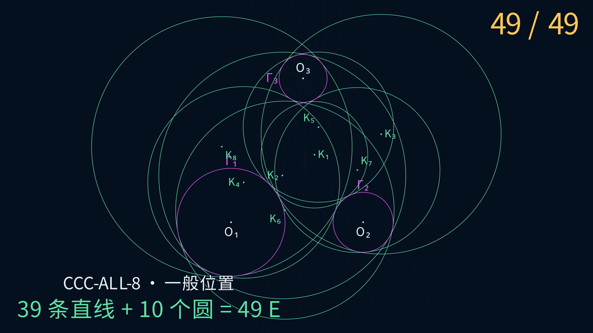

# Euclid-CCC-Min · Straightedge-and-Compass Constructions for Apollonius' Problem

[简体中文](README.md) · **English**

**Given three pairwise strictly externally disjoint circles and their centers, use an unmarked straightedge and compass to construct a circle externally tangent to all three. When eight distinct finite tangent circles exist, construct all eight.**

The currently verified constructions use at most 18 E for the externally tangent circle; 39 lines and 10 circles, totaling 49 E, for all eight targets in generic position; and at most 55 E in the worst case over the full eight-solution domain. **These are construction upper bounds; global minimality has not been proved.**

This project studies the CCC case of Apollonius' problem: circle–circle–circle. It seeks to reduce the number of straightedge-and-compass moves and provides step-by-step animations, exact construction replays, general-parameter proofs, and local searches.

[Watch the 49 E animation](https://raw.githubusercontent.com/lenovobenben/euclid-ccc-min/main/animations/e49/media/E49Progress_4k60.mp4) · [18 E external-circle animation](https://raw.githubusercontent.com/lenovobenben/euclid-ccc-min/main/animations/e18/media/E18External_4k60.mp4) · [Construction proofs](docs/MANNHEIM.md) · [Exact replay](experiments/replay_mannheim_kp_center_locus_dependencies.py)

[](https://raw.githubusercontent.com/lenovobenben/euclid-ccc-min/main/animations/e49/media/E49Progress_4k60.mp4)

*Click the preview to view or download the animation: 3840 × 2160, 60 fps, approximately 1 minute 39 seconds.*

## Explore the constructions

| Animation | Video | Target |
|---|---|---|
| All eight circles in 49 E | [4K60 MP4](https://raw.githubusercontent.com/lenovobenben/euclid-ccc-min/main/animations/e49/media/E49Progress_4k60.mp4) | All eight tangent circles in generic position, using 39 lines + 10 circles |
| External circle in 18 E | [4K60 MP4](https://raw.githubusercontent.com/lenovobenben/euclid-ccc-min/main/animations/e18/media/E18External_4k60.mp4) | A circle externally tangent to each input, using 15 lines + 3 circles |
| Enclosing circle in 18 E | [4K60 MP4](https://raw.githubusercontent.com/lenovobenben/euclid-ccc-min/main/animations/e18/media/E18Internal_4k60.mp4) | A circle enclosing and internally tangent to each input, using 15 lines + 3 circles |

The videos have Chinese captions and follow the visual style of [Euclid-Min](https://github.com/lenovobenben/euclid-min): magenta for the free input circles, gold for the current move, pale blue for auxiliary objects, and green for target circles. Each draw highlights its two existing reference points; circle draws show the center, a point on the circumference, and a temporary radius.

Geometry is exported from the exact construction replay; Manim handles display. The eight target circles are drawn at moves **29, 31, 35, 37, 41, 43, 47, and 49 E**, with the externally tangent circle drawn at 29 E. Each 18 E animation starts independently from the three input circles. They share their first 14 moves with each other, but are not prefixes of the 49 E animation. The enclosing-circle animation demonstrates strictly generic position and does not establish a full-domain 18 E bound for that target.

See the [49 E animation guide](animations/e49/README.md), [18 E animation guide](animations/e18/README.md), and [49 E storyboard](animations/e49/STORYBOARD.md) for data export and rendering.

## Current verified upper bounds

The project tracks two targets separately:

- **`CCC-EXT-1`**: actually draw the unique circle externally tangent to all three inputs.
- **`CCC-ALL-8`**: actually draw all eight distinct target circles, in any order.

| Coverage | External circle `CCC-EXT-1` | All eight circles `CCC-ALL-8` |
|---|---:|---:|
| Generic `gen` | **18 E** | **49 E** |
| Full-domain robust `rob` | **18 E** | **55 E** |

**Both 49 E and 55 E require the same eight target circles. Even when all eight exist, the intermediate steps of the 49 E program can fail at special configurations.** These exceptional inputs form a measure-zero subset of the eight-solution domain $D_8$. Generic coverage (`gen`) may exclude them; full-domain robust coverage (`rob`) must handle every one, with a current worst-case upper bound of 55 E. The distinction and a concrete example are explained below.

Each column takes the best currently verified program for that target; the programs may differ. The table therefore does not imply that one 49 E program draws the external circle at move 18. Obtaining a center, radius, contact point, or defining equation alone does not complete a circle target.

### Inputs and the eight-solution domain

Only three centers and three complete circles are given for free:

$$
\Gamma_i=(O_i,r_i),\qquad r_i>0,\qquad i=1,2,3.
$$

The input circles are pairwise strictly externally disjoint, their radii are pairwise distinct, their centers are noncollinear, and their three center distances are pairwise distinct. Within this domain, $D_8$ additionally requires exactly eight distinct, finite, positive-radius tangent circles. Inputs for which a solution degenerates into a common tangent line are outside $D_8$.

For each input circle, a target $(X,R)$ satisfies one of:

$$
|XO_i|=R+r_i
\quad\text{or}\quad
\bigl(R>r_i\ \land\ |XO_i|=R-r_i\bigr).
$$

The first relation is external tangency; the second means that the target encloses the input circle and is internally tangent to it. The external-circle target satisfies the first relation for all three inputs and is unique on $D_8$.

Radius endpoints, center lines, coordinate axes, and unit lengths are not supplied for free. Relabeling is allowed, but creates no geometric objects. See [DESIGN, Section 3](docs/DESIGN.md#3-两个独立研究问题) for the full input domain and its exact characterization by four quadratic equations.

### Why distinguish 49 E and 55 E when all eight circles exist?

There are two different kinds of degeneracy: **degenerate targets** and **degenerate intermediate construction steps**.

| Situation | Do all eight distinct finite target circles exist? | Coverage in this project |
|---|---|---|
| A solution degenerates into a common tangent line, or another target degeneracy occurs | No | Outside $D_8$; neither bound promises coverage |
| All eight targets exist, but auxiliary points merge or auxiliary lines become parallel | Yes | Inside $D_8$; the regular 49 E program may fail, while the full program supplies repair branches |

Disjoint input circles, distinct radii, and noncollinear centers do not ensure that every auxiliary object of a particular construction is well positioned. The 49 E program also relies on conditions such as distinct auxiliary points for line draws, nonparallel defining chords for intersections, finite auxiliary intersections $K'$, and a radical center $S$ off the chosen center line $O_1O_2$. The radical center has equal power with respect to all three input circles. These conditions restrict Mannheim's regular construction, rather than the existence of the eight targets.

**A concrete input requiring a different branch.** Consider

$$
(O_1,r_1)=((0,0),3),\qquad
(O_2,r_2)=((12,0),2),\qquad
(O_3,r_3)=((3,9/2),1).
$$

This input belongs to $D_8$, but its radical center is $S=(149/24,0)$, exactly on $O_1O_2$. The regular program normally draws $O_3K'$, obtains $J=O_3K'\cap O_1O_2$, and joins $S$ to $J$ to locate the common center line of a target pair. For this input, $K'=S$ in each unmerged direction class, so $J=S$. The next step would use the same point twice to define a line and cannot be executed. All eight targets still exist; the current full program takes a legal alternative branch and uses exactly **55 E** here. See the [`root_on_ell` fixture](experiments/replay_mannheim_kp_center_locus_dependencies.py). These coordinates describe the example and supply no extra free inputs.

**What does measure zero mean?** The regular 49 E program excludes zero sets of finitely many nonidentically-zero algebraic conditions. Its remaining domain is relatively open, dense, and of full measure in $D_8$. Under a continuous input distribution with a density, the probability of landing exactly on an exceptional configuration is zero. An explicitly chosen exact input can still lie there. Covering only an easy region of positive measure is insufficient; a difficult region with nonempty interior cannot be discarded.

**The 55 E result is a deterministic algorithm with construction steps, branch conditions, and execution order specified in advance. The input determines the path; no construction method needs to be invented during execution. Its worst-case cost over the entire eight-solution domain $D_8$ is 55 E.** Branches use exact equality, coincidence, and parallelism tests on existing construction objects. Any extra draws needed for a decision must also count toward E. The algorithm does not execute the same 55 draws for every input.

Ordinary inputs can still use 49 E; special inputs may cost more or become cheaper through additional reuse. Existing exact replays include a simple-merge fixture at 51 E, a double-pair merge at 46 E, and a double-$K'$-parallel fixture at 55 E. The difference of 6 E is therefore not a fixed repair surcharge for every exceptional input. [Mannheim, Section 8.16](docs/MANNHEIM.md#816-统一有序分支证书与-61-e-饱和夹具) gives the local branch conditions and ordered execution framework for the earlier 61 E version; Sections 8.18–8.19 optimize the full algorithm to the current 55 E bound.

Failure of this 49 E program on an input does not prove that no other construction can solve that input within 49 E. Likewise, 55 E is not a lower bound for special inputs. Full coverage refers only to $D_8$, excluding equal radii, collinear centers, or fewer than eight finite solutions. See [DESIGN, Section 3.2](docs/DESIGN.md#32-输入域) for the domains and [Mannheim, Section 8.19](docs/MANNHEIM.md#819-有限-k-提前给出圆心线与完整-55-e-上界) for repairs and worst-case counting.

## What counts as an E move

| Operation | Cost |
|---|---:|
| Draw a complete line through two existing distinct points | 1 E |
| Draw a circle centered at an existing point through another existing point | 1 E |
| Obtain or name a determined finite real intersection of existing objects | 0 E |
| The three given centers and three input circles | 0 E |
| Execute the same line or circle draw again | Still 1 E |

The tools are an unmarked straightedge and a **collapsing compass**, which cannot retain its opening to transfer a distance directly. Apart from the three initial centers, every new point must be a finite real intersection of existing objects. Arbitrary points and points at infinity are forbidden. Equality, tangency, parallelism, intersection branches, and target detection require exact decisions.

All finite real intersections of a new object with existing distinct objects enter the state automatically. When there are two real intersections, both are available; naming one requires an exact, deterministic branch rule.

Composite tasks such as constructing a midpoint, perpendicular, parallel line, radical center, similarity center, tangent, or inversion must be expanded into elementary draws. Reusing an existing object can avoid a draw; a duplicate draw that was actually executed cannot be removed from the score.

For example, `Line(O1,O2)` costs 1 E and makes its intersections with the input circles available for free. Drawing a circle centered at `O3` through one of those existing intersections costs another 1 E. The sequence totals 2 E.

The elementary semantics follow the fixed versions of Euclid-Min's [E-move specification](https://github.com/lenovobenben/euclid-min/blob/792619b38d749643bc9d80da8110dc9cff5b4877/docs/METRICS.md) and [formal operation model](https://github.com/lenovobenben/euclid-min/blob/792619b38d749643bc9d80da8110dc9cff5b4877/docs/FORMAL_MODEL.md). [DESIGN](docs/DESIGN.md) defines the CCC-specific inputs, targets, and coverage requirements.

<details>
<summary>Show the precise generic and robust coverage requirements</summary>

For a program $P$, the generic domain must explicitly exclude finitely many nonidentically-zero algebraic degeneracy conditions:

$$
D_8^{\mathrm{gen}}(P)
=
D_8\setminus\bigcup_{j=1}^{m}Z(g_j).
$$

This domain must be relatively open, dense, and of full measure in $D_8$. Selecting only an easy region with nonempty interior is insufficient, and numerical probing cannot replace explicit degeneracy conditions. Coordinate normalization is for proofs and supplies no free geometric objects.

A robust program, or finitely many exact branches, must cover all of $D_8$; its score is the worst-case cost. Branch selection creates no objects. Any extra draws needed to decide a branch must also be charged.

The current 49 E program covers Mannheim's regular generic domain; the 55 E program handles the remaining inputs. See [Mannheim, Section 8](docs/MANNHEIM.md#8-首个精确校准实例) for intermediate degeneracies, repair branches, and coverage proofs. [DESIGN, Section 3.6](docs/DESIGN.md#36-双目标记分) distinguishes a program's scores from project upper bounds that take the best result separately for each target.

</details>

## Sources and project contribution

The underlying construction follows Mannheim's 1885 approach. Lemoine's 1892 expansion used 54 lines and 10 circles, but its parallel-line macro allowed arbitrary points and compass-opening transfer. Those 64 drawn objects are not a 64 E certificate under this project's rules. Substituting a legal 4 E parallel-line construction gives a naive 65 E expansion.

This project reduces the generic eight-circle construction to 49 E through shared chords, concurrence of contact chords at the radical center, common center lines for paired targets, and early center-line determination from finite $K'$. Degeneracy repairs yield the full-domain 55 E bound. Two exact labelings avoid the expensive role for the externally tangent target, giving its full-domain 18 E bound.

| Part of the 49 E program | Cost |
|---|---:|
| Shared preparation and eight batch lines | 13 E |
| Two seed contact chords | 5 + 4 = 9 E |
| The remaining two contact chords | 2 + 1 = 3 E |
| Four paired-target suffixes, including all eight target-circle draws | 4 × 6 = 24 E |
| **Total** | **49 E** |

See the [literature ledger](docs/LITERATURE.md) and [Mannheim reconstruction](docs/MANNHEIM.md) for sources, derivations, and the evolution of the count. The eight-circle program can share auxiliary objects and completed target circles; its cost cannot be estimated by multiplying the single-target count by eight.

## Exact verification

Mathematical decisions use Python's standard-library `Fraction`, custom real quadratic extensions, and exact polynomial arithmetic. Replays record dependencies, object identities, and reuse, and check tangency relations. Some searches use floating-point screening across several samples; animations and display data also use approximate coordinates. Neither replaces formal exact verification.

| Check | Result or purpose | Entry point |
|---|---|---|
| Naive legal expansion | 55 lines + 10 circles = 65 E | [Fixed-instance replay](experiments/replay_mannheim_fixed.py) |
| Finite-$K'$ center-line program | 49 E on the regular fixture; maximum eight-target cost 55 E across 14 fixtures | [Main eight-circle replay](experiments/replay_mannheim_kp_center_locus_dependencies.py) |
| Contact-chord, concurrence, and center-line identities | Exact general-parameter relations supporting shared constructions | [Contact chords](experiments/verify_mannheim_contact_chord_identity.py), [concurrence](experiments/verify_mannheim_tau_concurrence.py), [center lines](experiments/verify_mannheim_center_locus_kp_identity.py) |
| Two-labeling external-circle check | `full_domain_ext_upper = 18` | [Relabeling verification](experiments/verify_mannheim_ext_relabel.py) |
| Animation snapshots and search calibration | Export consistency, legal reference points, distinct targets, and positive search controls | [Tests](tests/) |

The 14 fixtures calibrate branch counts and worst-case examples. Full $D_8$ coverage relies on the general-parameter classification and proofs in [Mannheim](docs/MANNHEIM.md). Finite tests do not prove full-domain coverage, and bounded searches with no hits do not establish global move-count lower bounds.

## Reproduction

Core replays, symbolic checks, and animation data tests require only the **Python 3.10+ standard library**. Run from the repository root:

```sh
python3 experiments/replay_mannheim_fixed.py
python3 experiments/verify_mannheim_contact_chord_identity.py
python3 experiments/verify_mannheim_tau_concurrence.py
python3 experiments/verify_mannheim_center_locus_kp_identity.py
python3 experiments/replay_mannheim_kp_center_locus_dependencies.py
python3 experiments/verify_mannheim_ext_relabel.py
```

Key output includes:

```text
score {'lines': 55, 'circles': 10, 'total': 65, ...}
kp_center_locus_summary {'fixtures': 14, 'maximum_trace': 55, 'maximum_all_targets': 55, ...}
mannheim_ext_relabel {..., 'full_domain_ext_upper': 18}
```

The `regular` fixture in the eight-circle replay has `all_targets = 49`. On Windows PowerShell, replace `python3` with `py -3` if needed.

Run the regression checks:

```sh
python3 -m unittest discover -v
```

The standard-library environment runs eight animation data tests and two search-binding calibration tests. NumPy enables seven additional search calibration tests; a Manim environment enables four viewport and visibility tests. Tests requiring missing optional dependencies are skipped. These tests do not render videos.

Manim is only needed to rerender animations; NumPy is used by some searches. See [49 E rendering](animations/e49/README.md#渲染), [18 E export and rendering](animations/e18/README.md#导出检查与渲染), and the individual search scripts for setup and commands.

## Current research directions

| Target | Current upper bound | Next threshold |
|---|---:|---:|
| Generic eight-circle construction `all/gen` | 49 E | 48 E |
| Robust eight-circle construction `all/rob` | 55 E | 54 E |
| External circle `ext/gen`, `ext/rob` | 18 E | 17 E; currently paused |

The priority is shared preparation, reuse across direction classes, and alternative construction routes for all eight circles. Recent bounded experiments cover joint cores, shared-circle replacements, projection reuse, delayed center carriers, and Gergonne-pole and common-inversion interfaces. They have not produced a shorter complete program.

The Gergonne route has an exactly replayed 19 E **conditional module**; the 87 E full expansion remains a budget awaiting complete replay. The common-inversion audit establishes a product relation among the four discriminants and one inversion exchanging all four solution pairs. Some states provide a **conditional entry** that draws the inversion circle for one additional E, but subsequent short searches have not produced a net saving. These modules, relations, and local results are not new eight-circle bounds.

Before extending a search, review its existing scope and positive controls, and specify the new starting state, candidate shapes, budget, and how a successful candidate would fit into a complete program. See the [roadmap](docs/ROADMAP.md) and [research outlook, Sections 9–15](docs/RESEARCH_OUTLOOK.md#9-2026-10-11-有界试验记录) for detailed boundaries and stopping criteria.

## Documentation and code

The detailed research documents below are primarily in Chinese. The Chinese and English READMEs provide corresponding project overviews and reproduction instructions.

| Topic | Entry point |
|---|---|
| Formal inputs, targets, tools, and claim levels | [DESIGN](docs/DESIGN.md) |
| Mannheim general-parameter proofs and branch counts | [MANNHEIM](docs/MANNHEIM.md) |
| Gergonne-pole interface and conditional module | [GERGONNE](docs/GERGONNE.md) |
| Shared discriminants, common inversion, and suffix searches | [SHARED_INVERSION](docs/SHARED_INVERSION.md) |
| Research priorities, search boundaries, and resource planning | [ROADMAP](docs/ROADMAP.md), [RESEARCH_OUTLOOK](docs/RESEARCH_OUTLOOK.md) |
| Historical sources and rule comparability | [LITERATURE](docs/LITERATURE.md) |
| Exact replays, symbolic checks, searches, and audits | [experiments](experiments/) |
| Saved search records | [experiments/results](experiments/results/) |

The code consists of standalone Python research scripts that reuse one another: `replay_*` replays constructions; `verify_*` checks exact properties; `audit_*` audits interfaces; and `search_*`, `screen_*`, and `scan_*` perform bounded searches and scans.

[KpCenterLocusReplay](experiments/replay_mannheim_kp_center_locus_dependencies.py) is the main eight-circle entry point. [DependencyGraph](experiments/replay_mannheim_fixed.py) tracks paid dependencies; [ExactObjectGraph](experiments/replay_mannheim_three_block_dependencies.py) handles identity, aliases, and reuse. Earlier replay scripts retain counts from earlier optimization stages and should be interpreted accordingly.

## License and citation

Software, tests, build scripts, and configuration use [Apache 2.0](LICENSE). Mathematical documents, construction records, research data, and animations use [CC BY 4.0](LICENSE-CONTENT). Third-party material retains its own rights; see the [license scope](LICENSE-SCOPE.md).

When citing this project, credit **lenovobenben, Euclid-CCC-Min**, link to the [repository](https://github.com/lenovobenben/euclid-ccc-min), and identify the commit or version used. Attribute and mark changes to redistributed or adapted non-software material under CC BY 4.0.
