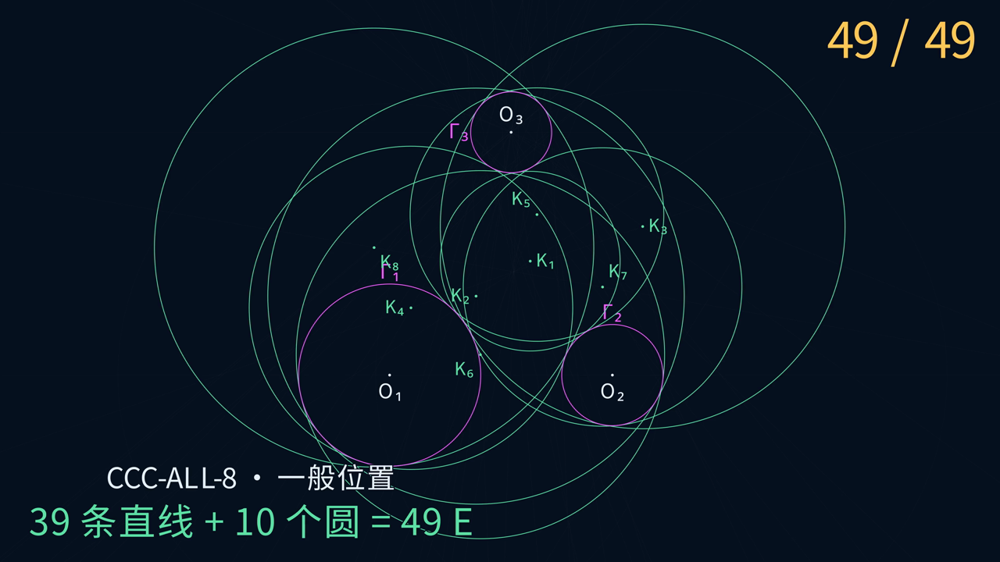

# Euclid-CCC-Min · 三圆相切的尺规构造

**简体中文** · [English](README.en.md)

**用 18 E 画出三重外切圆；在一般位置下，用 39 条直线和 10 个圆画出全部八个阿波罗尼乌斯圆。**

给定三个圆及其圆心，本项目研究阿波罗尼乌斯问题的 CCC 情形（圆—圆—圆），提供逐步动画、精确构造重放、一般参数证明与局部搜索。完整八解域上的当前最坏上界为 55 E。**18、49、55 E 都是已验证的构造上界，尚未证明全局最小。**

[观看 49 E 八解动画](https://raw.githubusercontent.com/lenovobenben/euclid-ccc-min/main/animations/e49/media/E49Progress_4k60.mp4) · [18 E 外切动画](https://raw.githubusercontent.com/lenovobenben/euclid-ccc-min/main/animations/e18/media/E18External_4k60.mp4) · [构造证明](docs/MANNHEIM.md) · [精确重放](experiments/replay_mannheim_kp_center_locus_dependencies.py)

[](https://raw.githubusercontent.com/lenovobenben/euclid-ccc-min/main/animations/e49/media/E49Progress_4k60.mp4)

*点击预览图查看或下载动画：3840 × 2160，60 fps，约 1 分 39 秒。*

## 先看演示

| 动画 | 成片 | 完成的目标 |
|---|---|---|
| 49 E 八解 | [4K60 MP4](https://raw.githubusercontent.com/lenovobenben/euclid-ccc-min/main/animations/e49/media/E49Progress_4k60.mp4) | 一般位置下全部八个相切圆，39 条直线 + 10 个圆 |
| 18 E 全外切 | [4K60 MP4](https://raw.githubusercontent.com/lenovobenben/euclid-ccc-min/main/animations/e18/media/E18External_4k60.mp4) | 与三个输入圆分别外切，15 条直线 + 3 个圆 |
| 18 E 全内切 | [4K60 MP4](https://raw.githubusercontent.com/lenovobenben/euclid-ccc-min/main/animations/e18/media/E18Internal_4k60.mp4) | 包住三个输入圆并分别内切，15 条直线 + 3 个圆 |

动画使用中文字幕，沿用 [Euclid-Min](https://github.com/lenovobenben/euclid-min) 的视觉风格：洋红色表示免费输入圆，金色表示当前一笔，淡蓝色表示辅助对象，绿色表示目标圆。每次落笔前标出两个已有定位点；画圆时标出圆心、圆上一点和临时半径。

几何数据由正式精确重放导出，Manim 负责显示。八解动画的目标绘制时刻为 **29、31、35、37、41、43、47、49 E**，其中三重外切圆在 29 E 画出。两条 18 E 动画各自从初始三圆开始，共用前 14 E 的构造；它们不是 49 E 动画的前缀。全内切动画只演示严格一般位置，不据此宣称全域 18 E 覆盖。

重新导出和渲染见 [49 E 动画说明](animations/e49/README.md)、[18 E 动画说明](animations/e18/README.md)及 [49 E 分镜](animations/e49/STORYBOARD.md)。

## 当前已验证上界

项目分别记录两个目标：

- **`CCC-EXT-1`**：实际画出唯一的三重外切圆。
- **`CCC-ALL-8`**：实际画出全部八个不同的目标圆，顺序不限。

| 覆盖口径 | 三重外切单解 `CCC-EXT-1` | 全部八解 `CCC-ALL-8` |
|---|---:|---:|
| 一般位置 `gen` | **18 E** | **49 E** |
| 完整鲁棒 `rob` | **18 E** | **55 E** |

`gen` 要求程序在八解域 $D_8$ 中一个开稠密、满测度的子域上成立；`rob` 要求处理 $D_8$ 的每个输入，包括辅助点合并、定义线平行等中间退化。两种口径要求画出的目标相同。

两列分别取当前最好已验证程序，可以来自不同构造。因此，上表不表示同一条 49 E 八解程序能在 18 E 画出外切圆。只得到圆心、半径、切点或确定目标的方程，也不算完成画圆。

### 正式输入与八解域

免费输入只有三个圆心和三个完整圆：

$$
\Gamma_i=(O_i,r_i),\qquad r_i>0,\qquad i=1,2,3.
$$

输入圆两两严格外离，半径两两不同，圆心不共线，三条圆心距离两两不同。在此基础上，$D_8$ 进一步要求恰有八个不同的有限、正半径相切圆。某个解退化为公切线的输入不属于 $D_8$。

目标圆 $(X,R)$ 对每个输入圆都满足以下关系之一：

$$
|XO_i|=R+r_i
\quad\text{或}\quad
\bigl(R>r_i\ \land\ |XO_i|=R-r_i\bigr).
$$

第一种是外切，第二种是目标圆包含输入圆并与之内切。三重外切目标对三个输入均满足第一种关系，在 $D_8$ 上唯一。

圆周上的半径端点、圆心连线、坐标轴和单位长度不免费提供。允许重新标号，但不能因此增加几何对象。输入域的完整定义与四个二次方程的精确判定见 [DESIGN 第 3 节](docs/DESIGN.md#3-两个独立研究问题)。

## E 步：唯一采用的计数法

| 操作 | 成本 |
|---|---:|
| 经过两个已有不同点画一条完整直线 | 1 E |
| 以一个已有点为圆心、经过另一个已有点画圆 | 1 E |
| 获得或命名已有对象的确定有限实交点 | 0 E |
| 三个给定圆心和三个输入圆 | 0 E |
| 再次执行一次相同的画线或画圆动作 | 仍计 1 E |

采用无刻度直尺和**塌圆规**，不允许保留开口来直接搬运距离。除三个初始圆心外，新点必须来自已有对象的有限实交点；不允许任取点或使用无穷远点。相等、相切、平行、交点分支与目标命中均须精确判定。

新图元与全部已有不同对象的有限实交点自动进入状态；若有两个实交点，两个点均可用，绑定名称时须采用精确、确定的分支规则。

作中点、垂线、平行线、根心、相似中心、切线或反演等复合操作，必须展开为实际画线和画圆。复用已有对象可以省去绘制；已经执行的重复动作不能从分数中删除。

例如，先画圆心连线 `Line(O1,O2)` 计 1 E，它与输入圆的交点免费出现；再以 `O3` 为圆心、经过其中一个已有交点画圆，另计 1 E。整段共 2 E。

基础语义沿用 Euclid-Min 固定版本的 [E 步计分规范](https://github.com/lenovobenben/euclid-min/blob/792619b38d749643bc9d80da8110dc9cff5b4877/docs/METRICS.md)与[正式操作模型](https://github.com/lenovobenben/euclid-min/blob/792619b38d749643bc9d80da8110dc9cff5b4877/docs/FORMAL_MODEL.md)。CCC 的输入、目标和覆盖口径以 [DESIGN](docs/DESIGN.md) 为准。

<details>
<summary>展开查看一般位置与完整鲁棒覆盖的精确定义</summary>

对程序 $P$，一般位置域必须明确排除有限个非恒零的代数退化条件：

$$
D_8^{\mathrm{gen}}(P)
=
D_8\setminus\bigcup_{j=1}^{m}Z(g_j).
$$

该域须在 $D_8$ 中相对开、稠密且满测度。不能仅选择一个具有内部的容易区域，也不能以浮点试探代替退化条件。坐标规范化只用于证明，不赠送免费几何对象。

完整鲁棒程序或有限个精确分支须覆盖整个 $D_8$，成本取最坏情况。分支选择不产生几何对象；若判定过程需要额外绘制，这些动作也要计 E。

当前 49 E 程序适用于 Mannheim 的正规一般位置域，55 E 程序补齐其余输入。中间退化分类、修复分支和覆盖证明见 [Mannheim 第 8 节](docs/MANNHEIM.md#8-首个精确校准实例)。程序分数与项目按目标分别取优的上界见 [DESIGN 第 3.6 节](docs/DESIGN.md#36-双目标记分)。

</details>

## 来源与项目贡献

构造主体来自 Mannheim 1885 路线，Lemoine 1892 给出了 54 条直线和 10 个圆的展开。但原有平行线宏允许任意点和异地搬运圆规开度，64 个已画对象不能直接计为本项目的 64 E。换入合法的 4 E 平行线程序后，朴素展开为 65 E。

本项目通过公共弦复用、接触弦共过根心、配对目标的公共圆心线，以及有限 $K'$ 提前定向圆心线，把一般位置八解降至 49 E；再加入退化修复分支，得到完整域 55 E。三重外切单解使用两种精确标号避开高成本角色，完整域上界为 18 E。

| 49 E 程序的部分 | 成本 |
|---|---:|
| 公共准备与八条批量线 | 13 E |
| 两条种子接触弦 | 5 + 4 = 9 E |
| 其余两条接触弦 | 2 + 1 = 3 E |
| 四组双目标后缀，包含八次目标画圆 | 4 × 6 = 24 E |
| **合计** | **49 E** |

完整来源、推导与计数演变见 [文献台账](docs/LITERATURE.md)和 [Mannheim 复原](docs/MANNHEIM.md)。八解可以共享辅助对象和已画目标圆，不能用单解步数乘八来估算总成本。

## 精确验证

数学判断使用 Python 标准库的 `Fraction`、自定义实二次扩域和精确多项式运算。重放记录对象依赖、身份与复用，并核对相切关系。部分搜索使用浮点多样本预筛；动画与显示数据也使用近似坐标，这些都不能代替正式精确验证。

| 核验 | 结果或作用 | 入口 |
|---|---|---|
| 朴素合法展开 | 55 条直线 + 10 个圆 = 65 E | [固定实例重放](experiments/replay_mannheim_fixed.py) |
| 有限 $K'$ 圆心线程序 | 正规夹具 49 E；14 个夹具的八解最大成本 55 E | [八解主重放](experiments/replay_mannheim_kp_center_locus_dependencies.py) |
| 接触弦、共点与圆心线恒等式 | 一般参数上的精确关系，支撑共享构造 | [接触弦](experiments/verify_mannheim_contact_chord_identity.py)、[共点](experiments/verify_mannheim_tau_concurrence.py)、[圆心线](experiments/verify_mannheim_center_locus_kp_identity.py) |
| 外切单解双标号 | `full_domain_ext_upper = 18` | [标号核验](experiments/verify_mannheim_ext_relabel.py) |
| 动画快照与搜索校准 | 导出一致性、合法定位点、目标区分和搜索阳性对照 | [测试](tests/) |

14 个夹具用于核对分支台账和饱和实例，完整 $D_8$ 覆盖依赖 [Mannheim 文档](docs/MANNHEIM.md)中的一般参数分类与证明。有限测试成功不能替代全域证明；有界搜索未命中也不能成为全局步数下界。

## 复现

核心重放、符号检查和动画数据测试只需 **Python 3.10+ 标准库**。从仓库根目录运行：

```sh
python3 experiments/replay_mannheim_fixed.py
python3 experiments/verify_mannheim_contact_chord_identity.py
python3 experiments/verify_mannheim_tau_concurrence.py
python3 experiments/verify_mannheim_center_locus_kp_identity.py
python3 experiments/replay_mannheim_kp_center_locus_dependencies.py
python3 experiments/verify_mannheim_ext_relabel.py
```

关键输出分别包括：

```text
score {'lines': 55, 'circles': 10, 'total': 65, ...}
kp_center_locus_summary {'fixtures': 14, 'maximum_trace': 55, 'maximum_all_targets': 55, ...}
mannheim_ext_relabel {..., 'full_domain_ext_upper': 18}
```

八解重放中，`regular` 夹具的 `all_targets` 为 49。Windows PowerShell 可将 `python3` 换成 `py -3`。

运行回归检查：

```sh
python3 -m unittest discover -v
```

标准库环境运行 8 项动画数据测试与 2 项搜索绑定校准。安装 NumPy 后另运行 7 项搜索校准；Manim 环境下另运行 4 项镜头与可见性测试。缺少对应依赖时自动跳过可选测试；这些测试不渲染视频。

Manim 只用于重新渲染动画，NumPy 用于部分搜索。环境和命令分别见 [49 E 渲染](animations/e49/README.md#渲染)、[18 E 导出与渲染](animations/e18/README.md#导出检查与渲染)和各搜索脚本说明。

## 当前研究方向

| 目标 | 当前上界 | 下一门槛 |
|---|---:|---:|
| 一般位置八解 `all/gen` | 49 E | 48 E |
| 完整鲁棒八解 `all/rob` | 55 E | 54 E |
| 三重外切 `ext/gen`、`ext/rob` | 18 E | 17 E，暂时暂停 |

优先研究八解的公共准备、跨方向共享和不同构造路线。近期有界试验覆盖联合核心、共享圆替换、投影复用、延迟圆心载体，以及 Gergonne 极点与公共反演接口，尚未得到更短的完整程序。

Gergonne 路线已精确重放 19 E **条件模块**；87 E 完整展开仍只是待重放预算。公共反演确认了四类判别式的乘积关系和交换四对解的同一反演；某些状态有追加 1 E 画反演圆的**条件入口**，后续短筛查尚未带来净节省。这些模块、关系与局部结果都不是新的八解成绩。

继续搜索前，先检查已有范围与阳性校准，明确新的起始状态、候选形状、预算，以及如何接回完整程序。详细边界和停止条件见 [研究路线](docs/ROADMAP.md)与 [研究展望第 9–15 节](docs/RESEARCH_OUTLOOK.md#9-2026-10-11-有界试验记录)。

## 文档与代码入口

以下详细研究文档以中文为主；本仓库的中英文 README 提供对应的项目概览与复现入口。

| 内容 | 入口 |
|---|---|
| 正式输入、目标、工具和声明等级 | [DESIGN](docs/DESIGN.md) |
| Mannheim 一般参数证明与分支台账 | [MANNHEIM](docs/MANNHEIM.md) |
| Gergonne 极点接口与条件模块 | [GERGONNE](docs/GERGONNE.md) |
| 判别式共享、公共反演与后缀筛查 | [SHARED_INVERSION](docs/SHARED_INVERSION.md) |
| 研究优先级、搜索边界与投入安排 | [ROADMAP](docs/ROADMAP.md)、[RESEARCH_OUTLOOK](docs/RESEARCH_OUTLOOK.md) |
| 历史来源与规则可比性 | [LITERATURE](docs/LITERATURE.md) |
| 精确重放、符号核验、搜索与审计 | [experiments](experiments/) |
| 已保存的搜索记录 | [experiments/results](experiments/results/) |

代码由独立运行、相互复用的 Python 研究脚本组成：`replay_*` 重放构造；`verify_*` 核验精确性质；`audit_*` 审计接口；`search_*`、`screen_*` 和 `scan_*` 执行有界搜索与扫描。

八解主入口是 [KpCenterLocusReplay](experiments/replay_mannheim_kp_center_locus_dependencies.py)。[DependencyGraph](experiments/replay_mannheim_fixed.py)记录计费依赖，[ExactObjectGraph](experiments/replay_mannheim_three_block_dependencies.py)处理身份、别名和复用。旧版重放保留不同优化阶段的台账，其分数应按对应阶段解读。

## 许可与引用

代码、测试、构建脚本和配置采用 [Apache 2.0](LICENSE)；数学文档、构造记录、研究数据和动画采用 [CC BY 4.0](LICENSE-CONTENT)。第三方材料的权利不受本项目许可改变，详见[许可范围](LICENSE-SCOPE.md)。

引用本项目时请注明 **lenovobenben，Euclid-CCC-Min**、[仓库地址](https://github.com/lenovobenben/euclid-ccc-min)及所用提交或版本；转载或改编非软件内容时按 CC BY 4.0 署名并注明修改。
